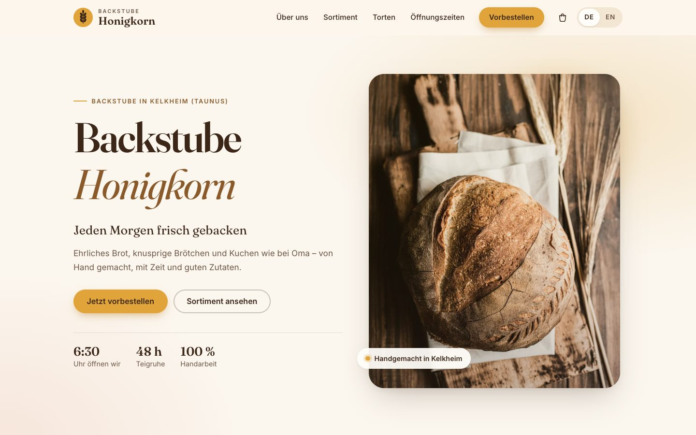
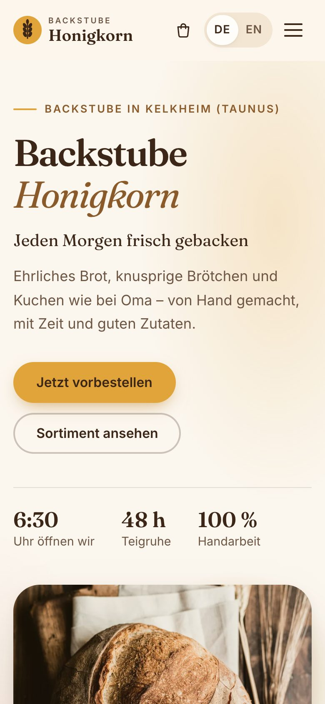
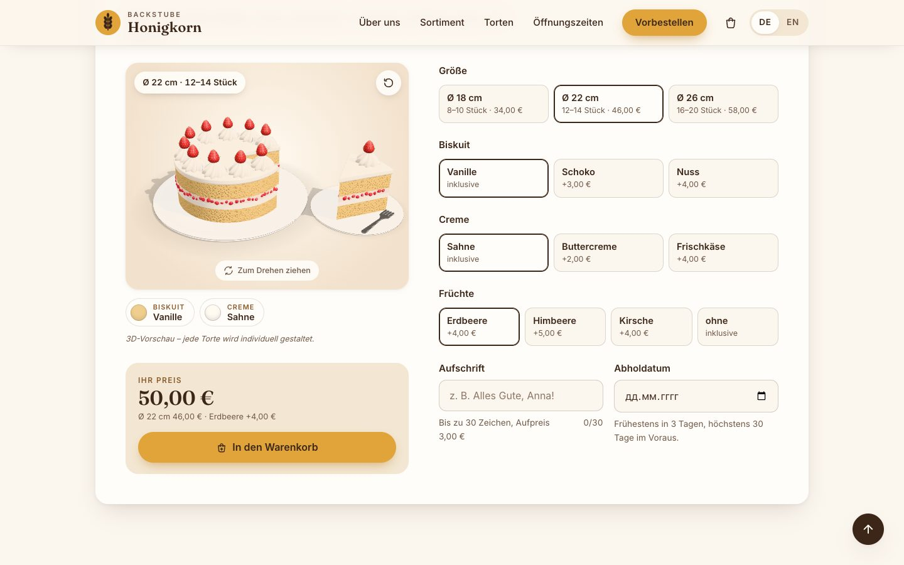
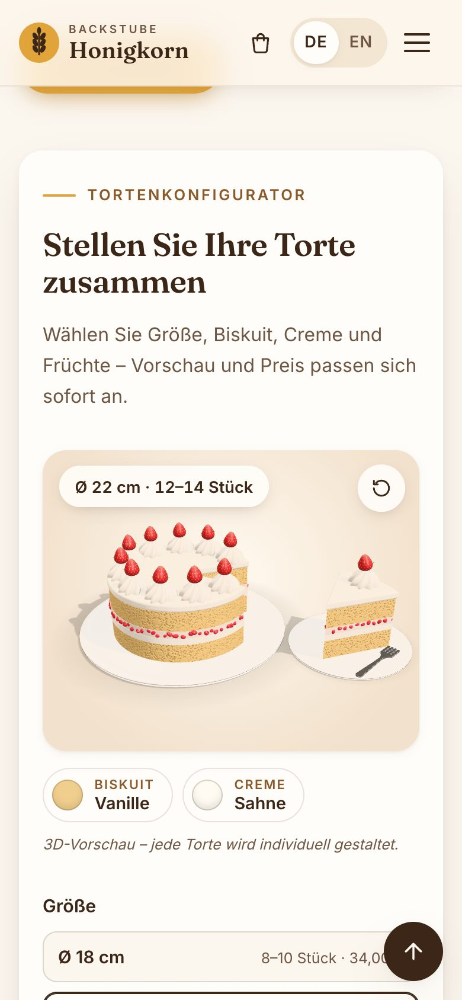

# Backstube Honigkorn

> **Demo-Projekt – keine echte Bäckerei.** A fictional bakery in Kelkheim (Taunus), built as a portfolio project.
> All contact details (Musterstraße 12, +49 0000 000000, hallo@honigkorn.example) are placeholders.

**Live demo:** [honigkorn-bakery.vercel.app](https://honigkorn-bakery.vercel.app)

A one-page landing site for a small German bakery: products with allergen info, a cart for pre-orders,
a 3D cake builder and a map that respects the GDPR (DSGVO). Plain HTML, CSS and JavaScript, no framework and no build step.

| Desktop | Mobile |
|---|---|
|  |  |
|  |  |

## Features

- **German / English.** German is the default; the language switch is remembered in `localStorage`. Prices and dates are formatted with `Intl` (de-DE / en-GB).
- **Product filter.** Accessible ARIA tabs (all, bread, rolls, sweets, cakes). On phones the row scrolls sideways, with edge fades and a one-time nudge that shows it can scroll.
- **Product details with EU allergens.** A modal with ingredients, weight and the 14 EU allergens (plus traces) as icons. Focus trap, Esc to close, focus returns to where you were.
- **Cart.** Add products and custom cakes, change quantities, see the total. Stored in `localStorage`. "Zur Vorbestellung" fills the pre-order form.
- **3D cake builder.** Choose size, sponge, cream, fruit and an inscription; the price updates live. The cake is modelled in code with [three.js](https://threejs.org) (r169, served locally). A slice glides onto a plate, and you can drag to rotate.
  - **Fallback:** without WebGL, or with "reduce motion" turned on, it shows pre-rendered stills of the same model.
  - **Light on resources:** it renders only while visible, and the mode it picked is logged to the console.
- **Pre-order form.** Validated on the client (name, phone, order, pickup date tomorrow…+30 days). It never sends data; it just says "Danke! Dies ist eine Demo."
- **Accessibility.** Semantic HTML, skip link, keyboard support, visible focus, WCAG AA contrast, `prefers-reduced-motion` respected.

### Privacy by design (DSGVO)

- **No cookies, trackers or analytics.**
- **Fonts and libraries are self-hosted.** Fraunces + Inter (`fonts/`), three.js and Leaflet (`vendor/`). No Google Fonts and no CDNs.
- **Map with a two-click solution.** At first you only see a drawn placeholder map with a notice. OpenStreetMap tiles load only after you click "Karte laden" (Leaflet itself is served locally). "Karte immer laden" remembers the choice and can be revoked. The privacy page has a section on it.
- **No external requests before that click.** Until you load the map, the page requests nothing from any other server.

## Tech stack

- HTML, CSS (mobile-first, custom properties) and vanilla JavaScript; no framework, no bundler.
- [three.js](https://threejs.org) r169 (MIT) for the 3D cake, [Leaflet](https://leafletjs.com) 1.9.4 (BSD-2-Clause) for the map. Both are vendored in `vendor/` with their licenses.
- Fonts: [Fraunces](https://github.com/undercasetype/Fraunces) and [Inter](https://github.com/rsms/inter), both SIL Open Font License (`fonts/`).
- Hosted on Vercel as a static site.

```
index.html, impressum.html, datenschutz.html
css/style.css
js/i18n.js           DE/EN texts
js/products-data.js  products, allergens, cake options and prices
js/main.js           language switch, menu, filter, form, reveal-on-scroll
js/dialog.js         accessible dialog helper (cart drawer, product modal)
js/cart.js  js/modal.js  js/cake-builder.js  js/map.js
js/cake-3d.js        3D cake preview (ES module, loaded only when WebGL works)
images/  fonts/  vendor/
```

## Run locally

No install needed. Any static server works:

```bash
git clone https://github.com/ZoiaPZP/honigkorn-bakery.git
cd honigkorn-bakery
python3 -m http.server 8080
# open http://localhost:8080
```

Open the site through a server, not as a `file://` path; otherwise the ES module for the 3D preview does not load and the builder shows the stills.

## Image credits / Bildnachweise

All photos come from [Unsplash](https://unsplash.com) and are used under the [Unsplash License](https://unsplash.com/license). They are stored locally, and the site does not hotlink Unsplash.

The full list of photographers is in [CREDITS.md](CREDITS.md) and on the site's [Impressum](impressum.html) page. The cake builder images are renders of the site's own 3D model.

## Deutsch

Backstube Honigkorn ist eine **erfundene Bäckerei** in Kelkheim (Taunus) – ein Portfolio-Projekt, keine echte Bäckerei. Die Seite ist zweisprachig (DE/EN), mit Sortimentsfilter, Produktdetails mit den 14 EU-Allergenen, Warenkorb, 3D-Tortenkonfigurator und einem Vorbestellformular, das keine Daten sendet. Datenschutz steht im Mittelpunkt: keine Cookies, kein Tracking, Schriften und Bibliotheken lokal, die OpenStreetMap-Karte lädt erst nach Einwilligung (Zwei-Klick-Lösung).

**Demo-Projekt – keine echte Bäckerei.**

---

Code © 2026 Zoia Plus. Photos: Unsplash License (see credits). Fonts: SIL OFL. three.js: MIT. Leaflet: BSD-2-Clause.
